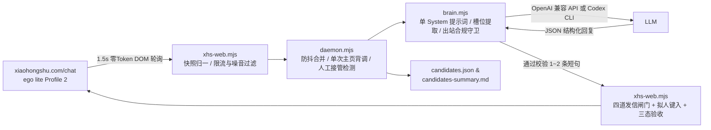

# xhs-dm-agent

**Zero-dependency AI DM screening & auto-reply daemon for Xiaohongshu (小红书 / RedNote) personal web chat (`xiaohongshu.com/chat`), built on `ego lite` browser automation.**

> 基于 `ego lite` 真实浏览器隔离环境的**小红书普通个人号网页私信 AI 自动回复与候选人筛选守护进程**——零第三方 npm 依赖，内置**主页背调、结构化槽位提取、四道发信防错发闸门、三态发送验收、出站合规守卫与人工无缝接管**。

[](https://nodejs.org/)
[](#)
[](#环境准备)
[](./LICENSE)

---

## 为什么做这个项目？（Why xhs-dm-agent）

市面上常见的小红书私信工具主要分为两类：面向企业/商业号「私信通」后台的油猴插件，或体量庞大的商业全渠道 SCRM。当你只是用**普通小红书个人号**发了一篇招募贴、约拍互免贴、活动搭子贴或合作征集贴，面对几十条高频涌入的网页版私信（`xiaohongshu.com/chat`）时，往往面临四个工程痛点：

1. **极易发错人**：防抖等待或模型思考期间切走了会话，把给 A 的回复发给了 B。
2. **机械感太重 / 踩风控**：0ms 瞬间粘贴一整段话、说客服腔、连发问号、不小心吐出站外引流词（微信/VX/绿泡泡等），或反复刷对方主页触发滑块验证。
3. **盲目重发刷屏**：回车发出后遇到弱网/临时消息 ID，脚本以为没发成功又重发一遍。
4. **人机打架**：你手动介入回复了一句，脚本不知道你已经接管，继续在后台插嘴。

`xhs-dm-agent` 采用 **机械执行层（`xhs-web.mjs`）+ 智能决策层（`brain.mjs`）+ 守护调度层（`daemon.mjs`）** 三层解耦设计，专门解决上述真实工程问题。

---

## 核心特性（Key Features）

- **零第三方依赖（Zero Dependencies）**：纯原生 Node.js ESM 实现，不需要 `npm install` 任何包；通过系统 `curl.exe` + 临时 header 文件调用任意 OpenAI 兼容接口（DeepSeek / Gemini / 阿里云百炼 / OpenAI / 本地网关），自动适配代理并避免密钥泄露到进程命令行。
- **强隔离浏览器 Profile**：基于 `ego lite`（`ego-browser`）复刻真实已登录会话，**硬性拦截日常 `Profile 1`**，强制在独立自动化 Profile（如 `Profile 2`）的专属 TaskSpace 中运行，不干扰个人日常浏览。
- **四道发信闸门 & 三态验收**：
  - **闸门 1**：点击目标会话并校验 `activeUserId` 一致性。
  - **闸门 2**：清空残留草稿，按 2~4 字分段拟人键入（带标点微顿），消除 0ms 瞬时注入特征。
  - **闸门 3**：提交前最后一毫秒复核会话未漂移、无新来消息插队、输入框文本回显 100% 匹配，否则立即清空草稿并回滚状态。
  - **闸门 4**：提交后轮询校验 `confirmed / rejected / uncertain` 三态结果，遇到 `uncertain` 严禁盲目重发，并准确识别未回关「24 小时最多发 1 条」限流提示自动挂起。
- **单次轻背调 + 结构化筛选看板**：对每位新候选人仅同源拉取 1 次主页信息（IP 属地、简介、标签、近期笔记标题），避免频控；多轮对话自动提取结构化槽位并实时生成 Markdown 进度表（`待拍板 / 自动沟通中 / 已人工接管 / 已淘汰`）。
- **出站合规守卫 & 人工无缝接管**：
  - 机械拦截站外引流词变体（微信/VX/加V/绿泡泡/WhatsApp/Telegram 等）、客服腔、超长句与连环发问；首次拦截自动让模型重写 1 次，二次仍违规自动阻断并切 `manual`。
  - 对方直接质疑「你是真人吗 / 机器人 / AI 吗」时，**零 LLM 调用**前置切人工。
  - 一旦检测到你自己在网页里手动发了消息，守护进程立刻让出控制权，永不抢话。
- **安全试跑与 `/new` 调试口令**：支持 `-DryRun` 模式（独立落盘 `candidates.dryrun.json`，只输出拟回复日志不真发），且在 `-DryRun` 下向测试号发 `/new` 或 `/new 你好` 即可一键重置历史，快速调优话术。

---

## 架构一览（Architecture）



| 模块 | 职责 |
| :--- | :--- |
| `xhs-web.mjs` | 小红书聊天页 DOM 适配、系统提示三分类（`limit` / `unsupported` / `noise`）、笔记卡片/图片提取、拟人分段键入、四道发信闸门与三态验收 |
| `brain.mjs` | 动态日期提示词组装（支持外部 `promptFile`）、结构化 JSON 解析与槽位无损合并、防抖合批、人机质疑前置转人工、出站合规守卫与自动重试、OpenAI 兼容接口（`curl.exe`）与 Codex CLI 兜底 |
| `daemon.mjs` | 单实例锁（`daemon.lock`）、`ego lite` Profile 2 安全绑定、老会话上下文承接（`seedHistoryFromDom`）、单次主页轻背调、`-DryRun` + `/new` 重置、原子写盘与失败回滚 |
| `start-daemon.ps1` | Windows PowerShell 5.1+ 启动器（UTF-8 with BOM），自动清理旧实例、按需重置 `NodeService` 并实时跟踪 `daemon.log` |

---

## 快速开始（Quick Start）

### 1. 环境准备
- **Windows 10/11** + **Node.js >= 20** + 系统自带 `curl.exe`
- 已安装 **[ego lite](https://github.com/citrolabs)**（`ego-browser.exe`），并在独立的自动化 Profile（如 `Profile 2`）中登录你的小红书网页版 `https://www.xiaohongshu.com/chat`
- 任意 OpenAI 兼容大模型 API Key（如 DeepSeek、Gemini、OpenAI、阿里云百炼等）

### 2. 配置与自定义提示词
```powershell
git clone https://github.com/deimos6677/xhs-dm-agent.git
cd xhs-dm-agent

# 1. 生成本地配置文件（已被 .gitignore 忽略，不会误提交）
Copy-Item config.example.json config.json

# 2. （推荐）复制一份自定义业务提示词模板
Copy-Item prompt.example.md prompt.local.md
```

编辑 `config.json`，填入你的 API 地址、密钥和模型，如需启用自定义业务提示词，将 `promptFile` 设为 `"prompt.local.md"`：

```json
{
  "provider": "openai",
  "apiBaseUrl": "https://api.deepseek.com/v1",
  "apiKey": "REPLACE_WITH_YOUR_API_KEY",
  "model": "deepseek-chat",
  "proxyUrl": "auto",
  "debounceMinMs": 2500,
  "debounceMaxMs": 3500,
  "maxRepliesPerTurn": 2,
  "profileId": "Profile 2",
  "spaceName": "xhs-dm-agent",
  "excludeSpaceNames": [],
  "promptFile": "prompt.local.md"
}
```

### 3. 运行单元测试与试跑验证
```powershell
# 运行全部离线单元测试（无需启动浏览器或消耗真实 API）
npm test

# 试跑模式（连接真实聊天页，仅打印拟回复日志，绝不真发消息）
.\start-daemon.ps1 -DryRun

# 确认日志和话术满意后，启动正式守护进程
.\start-daemon.ps1
```

> **调试技巧**：在 `-DryRun` 模式下，用测试号给当前账号发 `/new` 或 `/new 你好，想了解下细节`，守护进程会自动把该测试会话的本地记忆清零并按全新首轮重新推演，无需手动改 JSON。

---

## 配置项说明（Configuration）

| 字段 | 默认值 | 说明 |
| :--- | :--- | :--- |
| `provider` | `"openai"` | `"openai"`（调用 OpenAI 兼容 HTTP 接口）或 `"codex"`（调用本地 `codex exec`） |
| `apiBaseUrl` | `""` | OpenAI 兼容接口 Base URL（自动补齐 `/chat/completions`） |
| `apiKey` | `""` | 模型 API Key（仅存于本地 `config.json`，严禁提交） |
| `model` | `""` | 模型名称，如 `deepseek-chat`、`gemini-2.5-flash` 等 |
| `proxyUrl` | `"auto"` | `"auto"` 读取系统代理、`"direct"` 直连不走代理、或填自定义代理如 `"http://127.0.0.1:7890"` |
| `debounceMinMs` / `debounceMaxMs` | `2500` / `3500` | 对方连续发多条短消息时的防抖合批窗口（毫秒） |
| `maxRepliesPerTurn` | `2` | 非首轮最多拆分的自然短句条数（首轮强制 1 条完整开场） |
| `profileId` | `"Profile 2"` | 浏览器自动化专用 Profile（代码中硬性禁止 `"Profile 1"`） |
| `spaceName` | `"xhs-dm-agent"` | `ego lite` 中的专属 TaskSpace 名称 |
| `excludeSpaceNames` | `[]` | 同 Profile 下需避开的其他自动化空间名称列表 |
| `promptFile` | `""` | 可选外部提示词文件路径（支持 `{{TODAY}}` 动态日期占位符） |

---

## 致谢与设计参考（Acknowledgments）

本项目的安全闸门与 DOM 防护机制在工程实现中参考了多个优秀开源项目的思路：
- 会话归属复核与系统提示分类思路参考了 `xiaofang142/hivemtk`
- 提交后三态验收与幂等防重发思路参考了 `mimi17-shq/xiaohongshu-mcp-reliable`
- 单条 System 动态日期与出站守卫思路参考了 `IceNoproblem/xiaohongshu-auto-reply-skills`

---

## 免责声明（Disclaimer）

本项目仅供个人效率提升、浏览器自动化技术研究与学习交流使用。请严格遵守小红书平台用户协议与社区规范，切勿用于垃圾群发、恶意引流、骚扰或其他违规用途；使用本项目产生的账号风控或合规责任由使用者自行承担。
